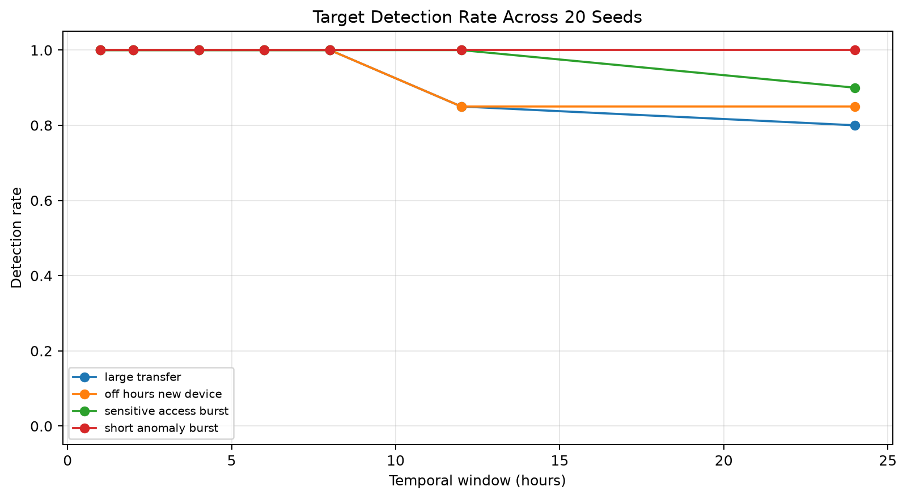
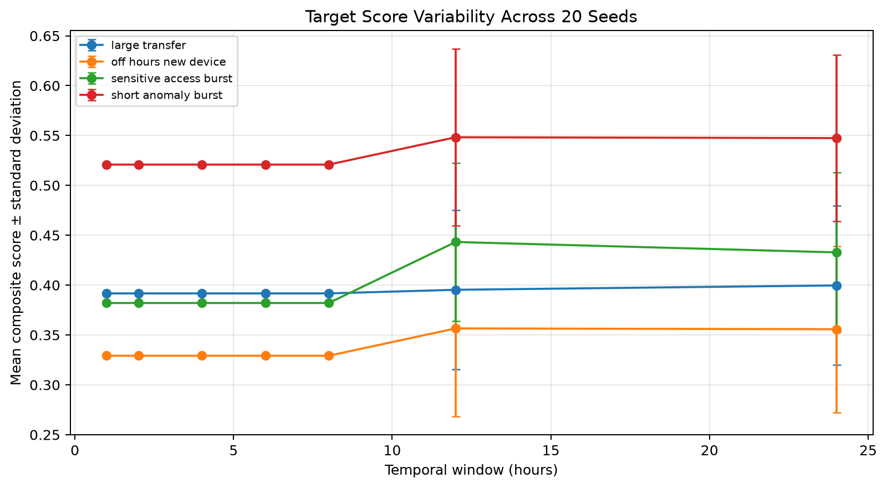
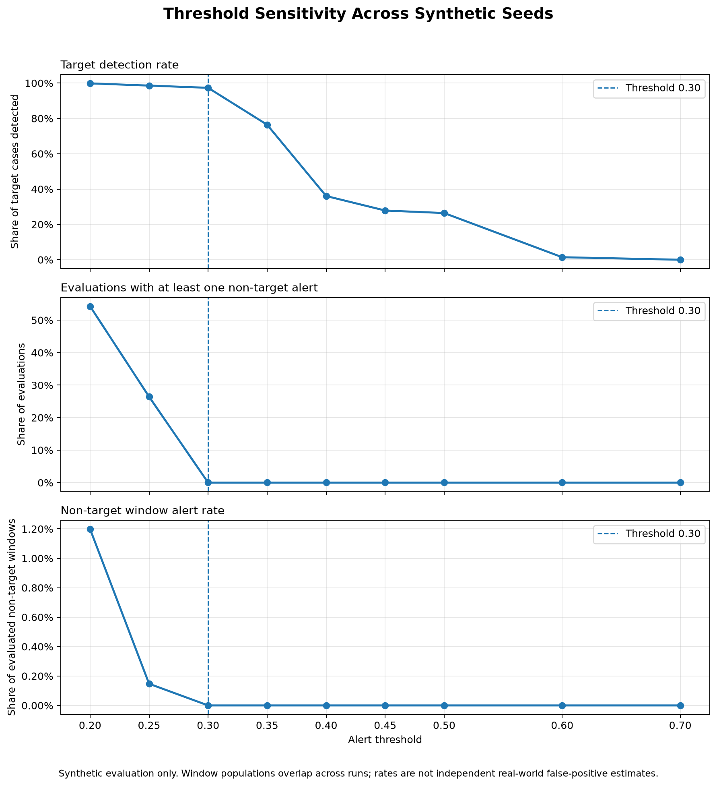

# AI-Based Temporal Behavioral Analysis for Early Insider Threat Detection

A research prototype investigating whether temporal patterns in user activity can support early identification of anomalous behavior associated with potential insider threats.

**Project:** M.Tech research project
**Status:** Research prototype — experimental evaluation in progress

## 1. Research Objectives

- Analyze user activity across configurable temporal windows.
- Develop behavioral features and temporal baselines.
- Evaluate Isolation Forest, LSTM autoencoder, and statistical/hybrid approaches.
- Study the effects of window duration, alert thresholds, scenario characteristics, and time of day.
- Measure precision, recall, F1-score, alert counts, and anomaly ranking.
- Produce reproducible experiment results and document methodological limitations.

Anomaly scores are investigation indicators, not proof of malicious intent. The system is not intended to automatically determine whether an individual is malicious.

## 2. Implemented Components

- Event ingestion, schema validation, and preprocessing.
- Data cleaning, normalization, and quality checks.
- Behavioral and temporal feature engineering.
- Temporal-window anomaly scoring and behavioral baselines.
- Isolation Forest and LSTM autoencoder experiments.
- Statistical/hybrid scoring and model comparison.
- Synthetic scenario generation and evaluation utilities.
- Automated tests and CSV experiment outputs.

## 3. Preliminary Experimental Results

These results come from controlled experiments with synthetic anomalies. They are exploratory and do not establish performance on real organizational data.

### Temporal-window comparison

Seven window sizes were evaluated: 1, 2, 4, 6, 8, 12, and 24 hours.

- The target anomaly was detected in all seven configurations.
- It ranked first in each configuration.
- No non-target alerts were recorded at the evaluated threshold.
- Target scores were approximately 0.706 for 1–8-hour windows, 0.778 for 12 hours, and 0.773 for 24 hours.

### Threshold sensitivity

The experiment evaluated 3,000 hourly results.

| Alert threshold | Alerts per setting | Non-target alerts | Target detected |
|---:|---:|---:|:---:|
| 0.20 | 61 | 60 | Yes |
| 0.25 | 9 | 8 | Yes |
| 0.30–0.70 | 1 | 0 | Yes |

These counts reflect the experiment's labels and configuration. Non-target activity is not necessarily benign in a real deployment.

### Scenario and time-of-day experiments

| Experiment | Evaluations | Target detected | Target ranking |
|---|---:|---:|---|
| Four synthetic scenarios × seven window sizes | 28 | 28/28 | First in each run |
| Seven anomaly times × seven window sizes | 49 | 49/49 | First in each run |

No non-target alerts were recorded in these controlled comparisons under the evaluated configuration.

### Model comparison

These figures come from one controlled synthetic target scenario. Models use different temporal representations, so the results should not be interpreted as a definitive model ranking.

| Model | Alerts | Precision | Recall | F1-score | Target rank |
|---|---:|---:|---:|---:|---:|
| Hourly Isolation Forest | 1 | 1.000 | 1.000 | 1.000 | 1 |
| LSTM autoencoder | 6 | 0.167 | 1.000 | 0.286 | 3 |
| Statistical/hybrid | 2 | 0.500 | 1.000 | 0.667 | 1 |

In the LSTM experiment, six contextual sequences overlapped the target anomaly. They must not be interpreted as six independent incidents. Exact-window and context-window evaluation results are documented separately.

## 4. Repository Structure

- `src/insider_threat/`: ingestion, preprocessing, features, detection, models, and evaluation.
- `scripts/`: experiment entry-point scripts.
- `tests/`: automated tests.
- `data/raw/`: tracked raw input data.
- `data/interim/`: locally generated processed data.
- `reports/experiment_results/`: experiment CSV outputs.
- `reports/`: research progress and model-comparison reports.

## 5. Technology Stack

Python 3.11+, NumPy, Pandas, SciPy, scikit-learn, PyTorch, Matplotlib, Seaborn, and Pytest.

## 6. Setup Instructions

These instructions are for Linux or Ubuntu.

### Clone and install

    git clone https://github.com/Jayramkumarcse/ai-temporal-insider-threat.git
    cd ai-temporal-insider-threat
    python3 -m venv .venv
    source .venv/bin/activate
    python -m pip install --upgrade pip
    python -m pip install -r requirements.txt
    python -m pip install -e . --no-deps

### Generate the intermediate dataset

The processed dataset is generated locally from the tracked raw data.

    python -c 'from insider_threat.preprocessing.pipeline import build_processed_events, save_processed_events; events = build_processed_events("data/raw/events.json"); save_processed_events(events, "data/interim/clean_events.json"); print(f"Processed events: {len(events)}")'

### Run the automated tests

Run from the repository root:

    python -m pytest -q

## 7. Experiment Outputs and Reports

Committed experiment results are stored in `reports/experiment_results/`:

- `temporal_window_comparison.csv`
- `threshold_sensitivity.csv`
- `scenario_window_comparison.csv`
- `time_of_day_comparison.csv`

Additional research reports:

- `reports/research_progress.md`
- `reports/lstm/round9_lstm_experiment.md`
- `reports/round10/round10_model_comparison.md`

### Run the experiments

From the repository root, with the virtual environment activated:

    python scripts/run_temporal_window_comparison.py
    python scripts/run_threshold_sensitivity.py
    python scripts/run_scenario_window_comparison.py
    python scripts/run_time_of_day_comparison.py
    python scripts/run_lstm_experiment.py
    python scripts/run_round10_comparison.py

Experiment scripts may regenerate result files when rerun.

## 8. Limitations

- Current evaluations use controlled experiments and synthetic anomaly scenarios.
- A limited number of scenarios cannot establish real-world detection effectiveness.
- Non-target activity is not necessarily benign in an operational environment.
- Overlapping temporal windows may represent the same underlying incident and must not automatically be counted as independent incidents.
- Thresholds and model performance need validation across more scenarios, random seeds, and representative datasets.
- Further external or real-world evaluation is required to assess generalization.

This repository is a research prototype, not a production-ready security monitoring system.

## 9. Future Research

Planned work includes expanding scenario coverage, testing robustness to threshold selection, improving temporal localization and event-level evaluation, and assessing generalization beyond the current controlled dataset.

## 10. Research Integrity

Research contributions should document experiment configurations, evaluation methods, assumptions, and limitations so that results can be reproduced and interpreted appropriately.

## 11. Experiment Visualizations

The following figures are generated by `scripts/plot_experiment_results.py` from the committed experiment CSV files.

### Temporal-window comparison

Compares target temporal and composite anomaly scores across window sizes.

### Threshold sensitivity

Shows how alert counts and non-target alert counts change with the threshold.

### Synthetic scenario comparison

Compares target composite scores across four synthetic anomaly scenarios and seven temporal window sizes.

### Time-of-day comparison

Shows target composite scores across anomaly hours in UTC and temporal window sizes.

To regenerate all figures, run:

    python scripts/plot_experiment_results.py

## 12. Multi-Seed Scenario Robustness Experiment

### Experimental design

Five background-generation seeds (7, 21, 42, 84, and 123) were evaluated across four controlled synthetic anomaly scenarios and seven window sizes (1, 2, 4, 6, 8, 12, and 24 hours). The alert threshold was held constant at 0.30, producing 140 evaluations.

### Results

- Target detections: 136 of 140 evaluations (97.1%).
- Target ranking: first in all 140 evaluations.
- Non-target alerts: zero in these controlled runs.
- All evaluated windows of 1–8 hours detected the target in all five seeds.
- At 12 and 24 hours, the large-transfer scenario detected the target in 3 of 5 seeds at each window size. The other three scenarios detected it in all five seeds at both sizes.
- The four missed detections occurred for the large-transfer scenario with seeds 84 and 123 at 12-hour and 24-hour windows.

The target can rank first without crossing the alert threshold. These results illustrate the difference between relative ranking and threshold-based alerting.

### Reproducibility artifacts

- `scripts/run_multi_seed_experiment.py`
- `reports/experiment_results/multi_seed_scenario_results.csv`
- `reports/experiment_results/multi_seed_scenario_summary.csv`

Run the experiment from the repository root using:

    python scripts/run_multi_seed_experiment.py

This is exploratory evidence from five seeds and four synthetic scenarios, not proof of real-world detection performance or generalization.

### Multi-seed detection robustness

Detection rate across five background-generation seeds for each synthetic scenario and temporal window size.

### Multi-seed score variability

Mean target composite score with standard deviation across the five seeds.

Regenerate these figures using:

    python scripts/plot_multi_seed_results.py

## 13. Extended 20-Seed Evaluation

The expanded study evaluated 20 synthetic background-generation seeds across four controlled anomaly scenarios and seven temporal window sizes, for 560 total evaluations at a fixed alert threshold of 0.30.

- Target detection: **545/560 (97.3%)**.
- Target ranked first in all 560 evaluations.
- No non-target alerts were recorded in this controlled experiment.
- Detection was 100% for window sizes from 1–8 hours, 92.5% for 12-hour windows, and 88.75% for 24-hour windows.
- Scenario detection rates were 95.0% for large transfer, 95.7% for off-hours new device, 98.6% for sensitive access burst, and 100% for short anomaly burst.

The 15 missed detections all occurred at 12-hour or 24-hour windows. Although the target ranked first in every run, the missed target scores were below the configured 0.30 alert threshold. Relative ranking is therefore not the same as threshold-based detection.

Reproduce the expanded experiment from the repository root:

    python scripts/run_multi_seed_experiment.py --seeds 1 2 3 4 5 6 7 8 9 10 11 12 13 14 15 16 17 18 19 20 --output-prefix extended_multi_seed_scenario

Results are stored separately from the original five-seed study:

- `reports/experiment_results/extended_multi_seed_scenario_results.csv`
- `reports/experiment_results/extended_multi_seed_scenario_summary.csv`

These are exploratory results from synthetic data. They do not establish real-world detection effectiveness or generalization.

## 14. Extended 20-Seed Visualizations

The following figures summarize the expanded evaluation across 20 synthetic background-generation seeds, four controlled scenarios, and seven temporal window sizes.

### Detection rate across 20 seeds

The figure compares target detection rates at each temporal window size. Detection was lower for longer windows in this experiment.

### Anomaly-score variability across 20 seeds

The figure shows the mean target composite score and standard deviation across seeds for each scenario and window size.

Regenerate these figures from the extended summary CSV using:

    python scripts/plot_multi_seed_results.py --summary extended_multi_seed_scenario_summary.csv --output-prefix extended_multi_seed

These results are exploratory and use synthetic data; they do not establish real-world detection effectiveness.

## 15. Multi-Seed Threshold Sensitivity

A threshold-sensitivity experiment evaluated the scoring system across 20 synthetic-data seeds, four scenarios, and seven temporal-window sizes. Each of the 560 seed–scenario–window combinations was evaluated at nine alert thresholds, producing 5,040 threshold-case rows.

### Overall results

| Threshold | Target detections | Detection rate | Non-target alert windows | Evaluations with at least one non-target alert |
|---:|---:|---:|---:|---:|
| 0.20 | 559/560 | 99.82% | 2,736 | 304/560 (54.29%) |
| 0.25 | 552/560 | 98.57% | 336 | 148/560 (26.43%) |
| **0.30** | **545/560** | **97.32%** | **0** | **0/560 (0%)** |
| 0.35 | 428/560 | 76.43% | 0 | 0/560 (0%) |
| 0.40 | 202/560 | 36.07% | 0 | 0/560 (0%) |
| 0.45 | 156/560 | 27.86% | 0 | 0/560 (0%) |
| 0.50 | 148/560 | 26.43% | 0 | 0/560 (0%) |
| 0.60 | 8/560 | 1.43% | 0 | 0/560 (0%) |
| 0.70 | 0/560 | 0.00% | 0 | 0/560 (0%) |

At threshold 0.30, scenario-level detection rates were 95.0% for `large_transfer`, 95.71% for `off_hours_new_device`, 98.57% for `sensitive_access_burst`, and 100% for `short_anomaly_burst`.

### Threshold-sensitivity figure

### Interpretation and limitations

Threshold 0.30 is a candidate operating point in this synthetic evaluation: it detected 545 of 560 target cases, with no observed alerts outside the exact target window. Lowering the threshold to 0.25 detected seven additional target cases but produced 336 non-target window alerts. Raising it to 0.35 reduced detection to 76.43%.

Here, a *non-target window* means a scored window other than the designated target window. It is not necessarily a verified benign window. The 228,240 non-target window evaluations overlap across temporal-window sizes and should not be treated as independent real-world observations. Consequently, zero non-target alerts at threshold 0.30 does not establish a zero operational false-positive rate.

These experiments use synthetic data and support exploratory comparison only. The threshold should be calibrated and validated on appropriately labeled, held-out telemetry before any operational deployment.

### Reproduction

The experiment and plotting scripts are:

- `scripts/run_multi_seed_threshold_sensitivity.py`
- `scripts/plot_threshold_sensitivity_multi_seed.py`

The experiment generates raw, overall-summary, and window-specific CSV files in `reports/experiment_results/`. Use a fresh `--output-prefix` when rerunning, because the runner intentionally refuses to overwrite existing output files.

## 16. Held-Out Evaluation of the Window-Aware Threshold Policy

### Policy selection and evaluation

The threshold-sensitivity study used seeds 1–20 to select this candidate policy:

- **1–8 hour windows:** alert threshold 0.30.
- **12–24 hour windows:** alert threshold 0.25.

The policy was then evaluated on seeds 21–40, which were not used to select the thresholds. Each cohort contains 560 seed–scenario–window cases across four synthetic scenarios and seven window sizes.

### Development versus held-out results

| Cohort | Policy | Target detections | Non-target alerts |
|---|---|---:|---:|
| Development, seeds 1–20 | Fixed threshold 0.25 | 552/560 (98.57%) | 336 |
| Development, seeds 1–20 | Fixed threshold 0.30 | 545/560 (97.32%) | 0 |
| Development, seeds 1–20 | Window-aware candidate | 552/560 (98.57%) | 0 |
| Held-out, seeds 21–40 | Fixed threshold 0.25 | 549/560 (98.04%) | 372 |
| Held-out, seeds 21–40 | Fixed threshold 0.30 | 539/560 (96.25%) | 0 |
| Held-out, seeds 21–40 | Window-aware candidate | 549/560 (98.04%) | 0 |

### Held-out breakdown

The candidate policy detected 100% of target cases for each window size from 1 through 8 hours. Detection was 75/80 (93.75%) at 12 hours and 74/80 (92.50%) at 24 hours.

By scenario, held-out detection was 137/140 (97.86%) for `large_transfer`, 132/140 (94.29%) for `off_hours_new_device`, and 140/140 (100%) for each of `sensitive_access_burst` and `short_anomaly_burst`.

### Interpretation and limitations

The candidate policy improved detection by 10 cases relative to fixed threshold 0.30 in the held-out cohort, while producing no observed non-target alerts. It matched fixed threshold 0.25's target detection count while avoiding the non-target alerts produced by that fixed threshold in this synthetic experiment.

These results support further investigation of window-aware thresholds, but do not establish a production-ready policy. A non-target window is not necessarily a verified benign example, and window evaluations overlap across window sizes. The zero observed alert count is not evidence of a zero real-world false-positive rate. Further evaluation on appropriately labeled, held-out real telemetry is required.

### Held-out artifacts

- Raw results: `reports/experiment_results/holdout_seed21_40_threshold_sensitivity_results.csv`
- Overall summary: `reports/experiment_results/holdout_seed21_40_threshold_sensitivity_summary.csv`
- Summary by window: `reports/experiment_results/holdout_seed21_40_threshold_sensitivity_by_window.csv`

The experiment used `scripts/run_multi_seed_threshold_sensitivity.py` with seeds 21–40 and the same nine thresholds as the development experiment.

## 17. 60-Seed Window-Aware Policy Comparison

### Policy evaluated

The candidate policy was selected using development seeds 1–20 and then applied without retuning to two additional cohorts:

- **1–8 hour windows:** threshold 0.30.
- **12–24 hour windows:** threshold 0.25.

The held-out cohort used seeds 21–40. The independent synthetic-seed replication used seeds 41–60. Each cohort covers four scenarios and seven window sizes, with 560 seed–scenario–window cases.

### Results by cohort

| Cohort | Policy | Target detections | Non-target alerts |
|---|---|---:|---:|
| Development, 1–20 | Fixed 0.25 | 552/560 (98.57%) | 336 |
| Development, 1–20 | Fixed 0.30 | 545/560 (97.32%) | 0 |
| Development, 1–20 | Window-aware | 552/560 (98.57%) | 0 |
| Held-out, 21–40 | Fixed 0.25 | 549/560 (98.04%) | 372 |
| Held-out, 21–40 | Fixed 0.30 | 539/560 (96.25%) | 0 |
| Held-out, 21–40 | Window-aware | 549/560 (98.04%) | 0 |
| Replication, 41–60 | Fixed 0.25 | 551/560 (98.39%) | 348 |
| Replication, 41–60 | Fixed 0.30 | 540/560 (96.43%) | 0 |
| Replication, 41–60 | Window-aware | 551/560 (98.39%) | 0 |

### Combined results across seeds 1–60

| Policy | Target detections | Detection rate | Non-target alerts |
|---|---:|---:|---:|
| Fixed threshold 0.25 | 1,652/1,680 | 98.33% | 1,056 |
| Fixed threshold 0.30 | 1,624/1,680 | 96.67% | 0 |
| Window-aware candidate | 1,652/1,680 | 98.33% | 0 |

Under this synthetic evaluation, the window-aware policy matches the detection count of fixed threshold 0.25 while avoiding its observed non-target alerts. It detects 28 more target cases than fixed threshold 0.30 across the combined cohort.

### Window-specific results

Across the 60 seeds, the window-aware policy detected 240/240 cases (100%) at each window size from 1 through 8 hours. At 12 hours it detected 226/240 (94.17%), and at 24 hours it detected 226/240 (94.17%).

### Interpretation and limitations

The results support further investigation of window-aware thresholding. However, a non-target window is not necessarily a verified benign example. The windows overlap across window sizes, and the evaluation is synthetic. Zero observed non-target alerts therefore does not establish a zero operational false-positive rate or prove that the policy is production-ready. Validation on appropriately labeled, held-out real telemetry remains necessary.

### Reproducibility artifacts

- Comparison script: `scripts/compare_window_aware_policy_cohorts.py`
- Cohort comparison: `reports/experiment_results/window_aware_policy_cohort_comparison.csv`
- Policy by window: `reports/experiment_results/window_aware_policy_by_window.csv`
- Policy by scenario: `reports/experiment_results/window_aware_policy_by_scenario.csv`
- Replication raw results: `reports/experiment_results/replication_seed41_60_threshold_sensitivity_results.csv`
- Replication overall summary: `reports/experiment_results/replication_seed41_60_threshold_sensitivity_summary.csv`
- Replication by-window summary: `reports/experiment_results/replication_seed41_60_threshold_sensitivity_by_window.csv`

Rebuild the consolidated comparison by running `python scripts/compare_window_aware_policy_cohorts.py`.
