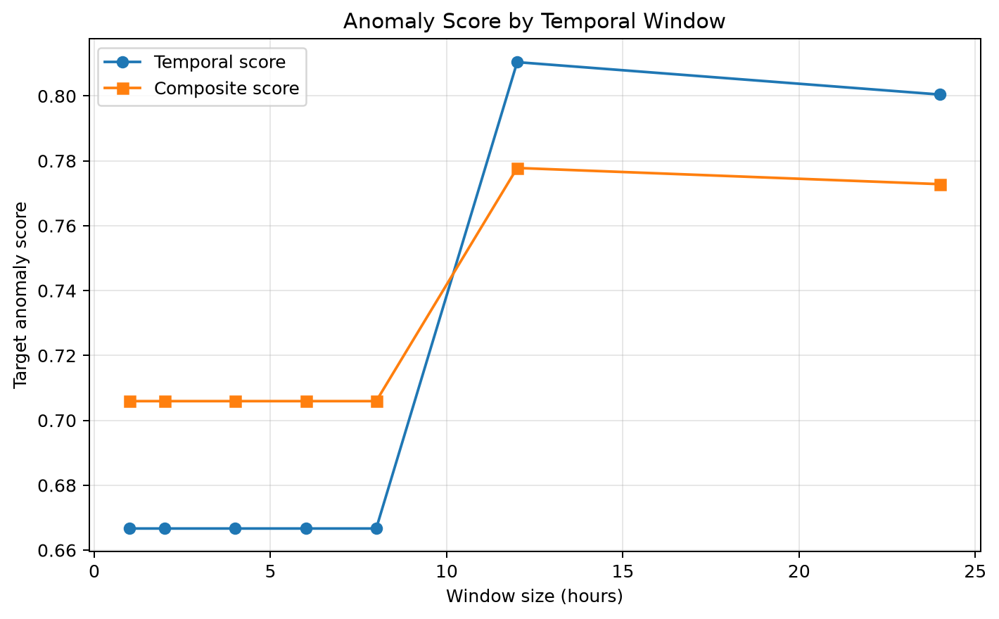
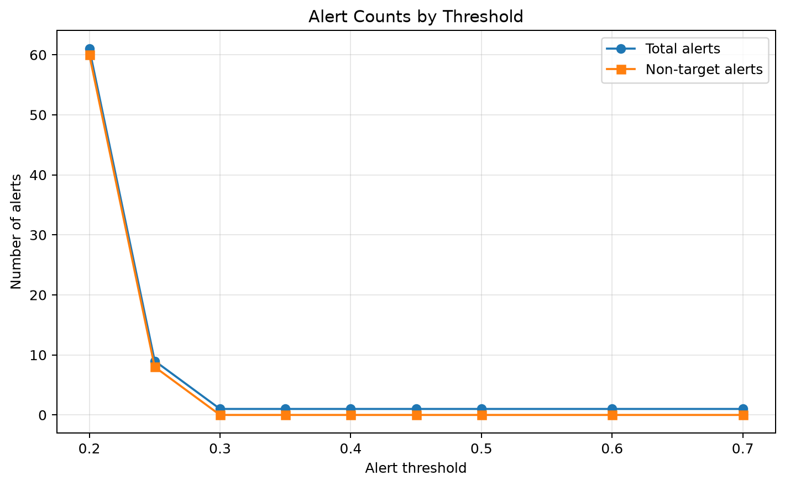
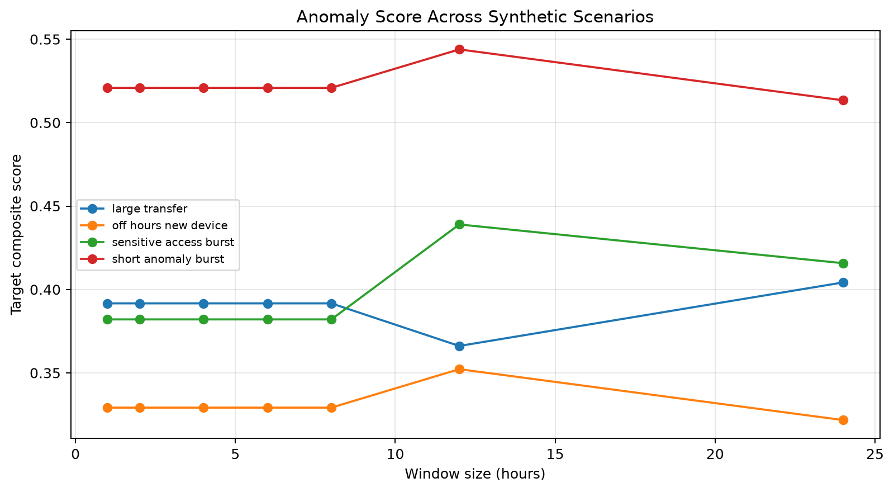
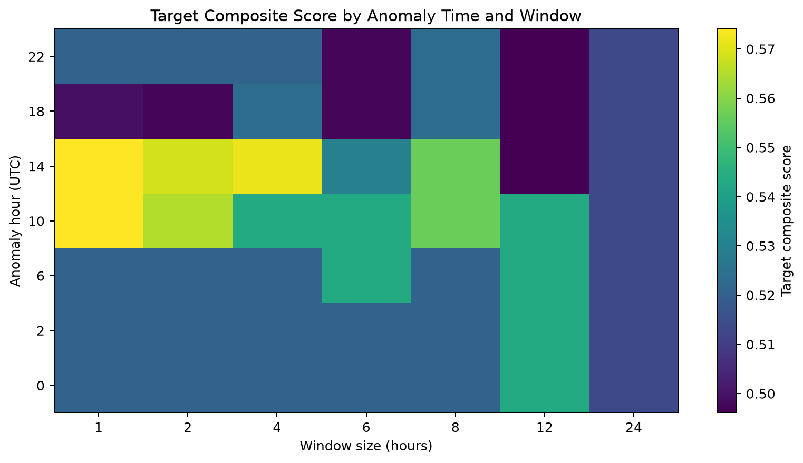
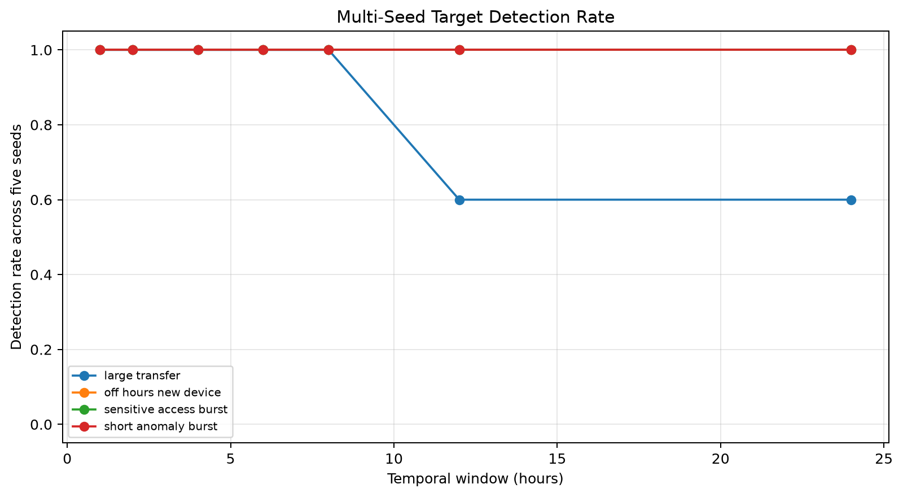
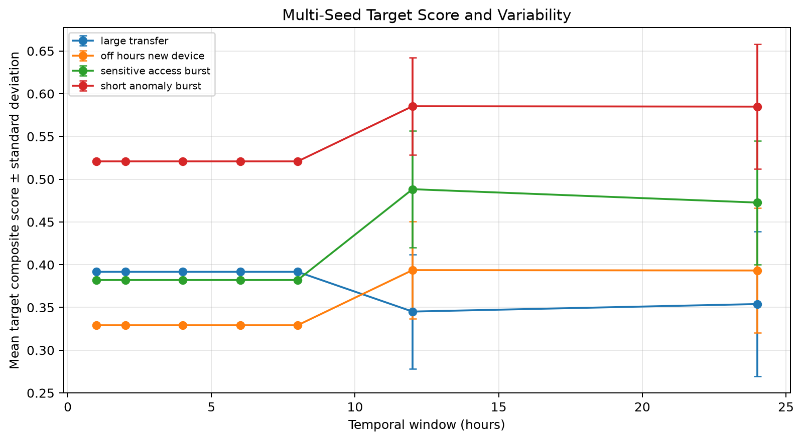

# AI-Based Temporal Behavioral Analysis for Early Insider Threat Detection

A research prototype investigating whether temporal patterns in user activity can support early identification of anomalous behavior associated with potential insider threats.

**Project:** M.Tech research project
**Status:** Research prototype — experimental evaluation in progress

## 1. Research Objectives

- Analyze user activity across configurable temporal windows.
- Develop behavioral features and temporal baselines.
- Evaluate Isolation Forest, LSTM autoencoder, and statistical/hybrid approaches.
- Study the effects of window duration, alert thresholds, scenario characteristics, and time of day.
- Measure precision, recall, F1-score, alert counts, and anomaly ranking.
- Produce reproducible experiment results and document methodological limitations.

Anomaly scores are investigation indicators, not proof of malicious intent. The system is not intended to automatically determine whether an individual is malicious.

## 2. Implemented Components

- Event ingestion, schema validation, and preprocessing.
- Data cleaning, normalization, and quality checks.
- Behavioral and temporal feature engineering.
- Temporal-window anomaly scoring and behavioral baselines.
- Isolation Forest and LSTM autoencoder experiments.
- Statistical/hybrid scoring and model comparison.
- Synthetic scenario generation and evaluation utilities.
- Automated tests and CSV experiment outputs.

## 3. Preliminary Experimental Results

These results come from controlled experiments with synthetic anomalies. They are exploratory and do not establish performance on real organizational data.

### Temporal-window comparison

Seven window sizes were evaluated: 1, 2, 4, 6, 8, 12, and 24 hours.

- The target anomaly was detected in all seven configurations.
- It ranked first in each configuration.
- No non-target alerts were recorded at the evaluated threshold.
- Target scores were approximately 0.706 for 1–8-hour windows, 0.778 for 12 hours, and 0.773 for 24 hours.

### Threshold sensitivity

The experiment evaluated 3,000 hourly results.

| Alert threshold | Alerts per setting | Non-target alerts | Target detected |
|---:|---:|---:|:---:|
| 0.20 | 61 | 60 | Yes |
| 0.25 | 9 | 8 | Yes |
| 0.30–0.70 | 1 | 0 | Yes |

These counts reflect the experiment's labels and configuration. Non-target activity is not necessarily benign in a real deployment.

### Scenario and time-of-day experiments

| Experiment | Evaluations | Target detected | Target ranking |
|---|---:|---:|---|
| Four synthetic scenarios × seven window sizes | 28 | 28/28 | First in each run |
| Seven anomaly times × seven window sizes | 49 | 49/49 | First in each run |

No non-target alerts were recorded in these controlled comparisons under the evaluated configuration.

### Model comparison

These figures come from one controlled synthetic target scenario. Models use different temporal representations, so the results should not be interpreted as a definitive model ranking.

| Model | Alerts | Precision | Recall | F1-score | Target rank |
|---|---:|---:|---:|---:|---:|
| Hourly Isolation Forest | 1 | 1.000 | 1.000 | 1.000 | 1 |
| LSTM autoencoder | 6 | 0.167 | 1.000 | 0.286 | 3 |
| Statistical/hybrid | 2 | 0.500 | 1.000 | 0.667 | 1 |

In the LSTM experiment, six contextual sequences overlapped the target anomaly. They must not be interpreted as six independent incidents. Exact-window and context-window evaluation results are documented separately.

## 4. Repository Structure

- `src/insider_threat/`: ingestion, preprocessing, features, detection, models, and evaluation.
- `scripts/`: experiment entry-point scripts.
- `tests/`: automated tests.
- `data/raw/`: tracked raw input data.
- `data/interim/`: locally generated processed data.
- `reports/experiment_results/`: experiment CSV outputs.
- `reports/`: research progress and model-comparison reports.

## 5. Technology Stack

Python 3.11+, NumPy, Pandas, SciPy, scikit-learn, PyTorch, Matplotlib, Seaborn, and Pytest.

## 6. Setup Instructions

These instructions are for Linux or Ubuntu.

### Clone and install

    git clone https://github.com/Jayramkumarcse/ai-temporal-insider-threat.git
    cd ai-temporal-insider-threat
    python3 -m venv .venv
    source .venv/bin/activate
    python -m pip install --upgrade pip
    python -m pip install -r requirements.txt
    python -m pip install -e . --no-deps

### Generate the intermediate dataset

The processed dataset is generated locally from the tracked raw data.

    python -c 'from insider_threat.preprocessing.pipeline import build_processed_events, save_processed_events; events = build_processed_events("data/raw/events.json"); save_processed_events(events, "data/interim/clean_events.json"); print(f"Processed events: {len(events)}")'

### Run the automated tests

Run from the repository root:

    python -m pytest -q

## 7. Experiment Outputs and Reports

Committed experiment results are stored in `reports/experiment_results/`:

- `temporal_window_comparison.csv`
- `threshold_sensitivity.csv`
- `scenario_window_comparison.csv`
- `time_of_day_comparison.csv`

Additional research reports:

- `reports/research_progress.md`
- `reports/lstm/round9_lstm_experiment.md`
- `reports/round10/round10_model_comparison.md`

### Run the experiments

From the repository root, with the virtual environment activated:

    python scripts/run_temporal_window_comparison.py
    python scripts/run_threshold_sensitivity.py
    python scripts/run_scenario_window_comparison.py
    python scripts/run_time_of_day_comparison.py
    python scripts/run_lstm_experiment.py
    python scripts/run_round10_comparison.py

Experiment scripts may regenerate result files when rerun.

## 8. Limitations

- Current evaluations use controlled experiments and synthetic anomaly scenarios.
- A limited number of scenarios cannot establish real-world detection effectiveness.
- Non-target activity is not necessarily benign in an operational environment.
- Overlapping temporal windows may represent the same underlying incident and must not automatically be counted as independent incidents.
- Thresholds and model performance need validation across more scenarios, random seeds, and representative datasets.
- Further external or real-world evaluation is required to assess generalization.

This repository is a research prototype, not a production-ready security monitoring system.

## 9. Future Research

Planned work includes expanding scenario coverage, testing robustness to threshold selection, improving temporal localization and event-level evaluation, and assessing generalization beyond the current controlled dataset.

## 10. Research Integrity

Research contributions should document experiment configurations, evaluation methods, assumptions, and limitations so that results can be reproduced and interpreted appropriately.

## 11. Experiment Visualizations

The following figures are generated by `scripts/plot_experiment_results.py` from the committed experiment CSV files.

### Temporal-window comparison

Compares target temporal and composite anomaly scores across window sizes.

### Threshold sensitivity

Shows how alert counts and non-target alert counts change with the threshold.

### Synthetic scenario comparison

Compares target composite scores across four synthetic anomaly scenarios and seven temporal window sizes.

### Time-of-day comparison

Shows target composite scores across anomaly hours in UTC and temporal window sizes.

To regenerate all figures, run:

    python scripts/plot_experiment_results.py

## 12. Multi-Seed Scenario Robustness Experiment

### Experimental design

Five background-generation seeds (7, 21, 42, 84, and 123) were evaluated across four controlled synthetic anomaly scenarios and seven window sizes (1, 2, 4, 6, 8, 12, and 24 hours). The alert threshold was held constant at 0.30, producing 140 evaluations.

### Results

- Target detections: 136 of 140 evaluations (97.1%).
- Target ranking: first in all 140 evaluations.
- Non-target alerts: zero in these controlled runs.
- All evaluated windows of 1–8 hours detected the target in all five seeds.
- At 12 and 24 hours, the large-transfer scenario detected the target in 3 of 5 seeds at each window size. The other three scenarios detected it in all five seeds at both sizes.
- The four missed detections occurred for the large-transfer scenario with seeds 84 and 123 at 12-hour and 24-hour windows.

The target can rank first without crossing the alert threshold. These results illustrate the difference between relative ranking and threshold-based alerting.

### Reproducibility artifacts

- `scripts/run_multi_seed_experiment.py`
- `reports/experiment_results/multi_seed_scenario_results.csv`
- `reports/experiment_results/multi_seed_scenario_summary.csv`

Run the experiment from the repository root using:

    python scripts/run_multi_seed_experiment.py

This is exploratory evidence from five seeds and four synthetic scenarios, not proof of real-world detection performance or generalization.

### Multi-seed detection robustness

Detection rate across five background-generation seeds for each synthetic scenario and temporal window size.

### Multi-seed score variability

Mean target composite score with standard deviation across the five seeds.

Regenerate these figures using:

    python scripts/plot_multi_seed_results.py
